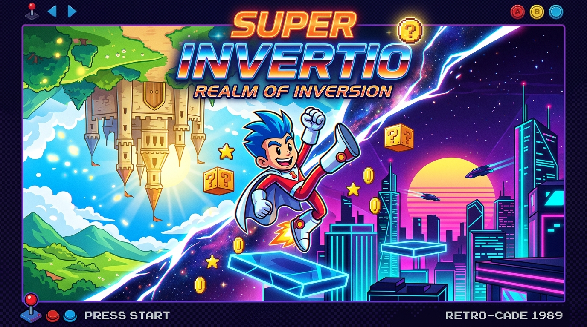
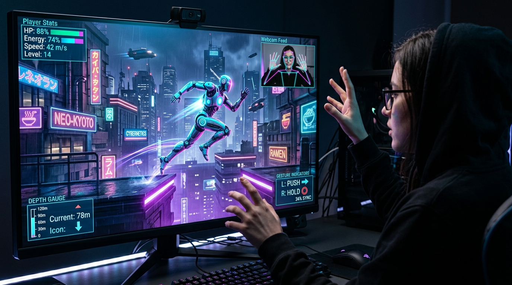

# POLARITY 3D: AI Camera Inversion Platformer

> **Hackathon Entry:** Open Forge Hackathon  
> **Theme:** **INVERSION** — Flipping or reversing something normally taken for granted.  
> **Tech Stack:** Three.js (3D WebGL), Modern ES6+ JavaScript, Web Audio API, Google MediaPipe Pose AI (Web), Pygame + OpenCV (Python Edition).




---

## 🎮 Play Immediately in Browser

Simply open [`game.html`](file:///e:/Open%20Forge%20Hackathon/game.html) in any modern web browser (Google Chrome, Microsoft Edge, Mozilla Firefox, Apple Safari).
*No build steps, no package managers, and zero installations required!*

Or view via local server: `http://localhost:8080/game.html`

Allow camera access when prompted to experience real-time gesture control with live 3D perspective and skeletal tracking!

---

## 📷 Smooth Camera Gesture Inversion Controls

Experience the hackathon **Inversion** theme through physical body gestures tracked live via your webcam:

| Physical Gesture | Camera Action | Inverted In-Game Result |
| :--- | :--- | :--- |
| **Raise Left Hand** | Left wrist elevated above shoulder | **Moves Character to the RIGHT ❯** |
| **Raise Right Hand** | Right wrist elevated above shoulder | **❮ Moves Character to the LEFT** |
| **Sit Down / Squat** | Torso / shoulder drops below baseline | **JUMP ⬆️ (Away from surface)** |
| **Raise Both Hands** | Both wrists raised high above head | **REALITY SHIFT (Cyan $\leftrightarrow$ Magenta)** |

*Keyboard Fallback:*
- `A` / `ArrowLeft`: Move Right (Inverted)
- `D` / `ArrowRight`: Move Left (Inverted)
- `W` / `Space`: Jump
- `Shift` / `E`: Reality Phase Shift
- `C` / `J`: Dash Burst
- `R`: Quick Respawn

---

## ⚙️ Camera Sensitivity Controls & Calibration (`js/settings.js`)

Click the **`[⚙️ SENSITIVITY]`** button in the HUD or Camera panel to fine-tune your tracking in real-time with calibrated presets:

- **⬇️ Squat / Sit-Down Depth Slider (`0.04 - 0.16`, Default: `0.115`)**:
  - Calibrated for **deliberate movement**: requires a distinct, intentional squat or sitting down before triggering a jump, eliminating false hops from minor slouching.
  - *Live Visual Feedback:* The yellow/orange trigger line in the camera mirror moves up and down dynamically as you drag the slider!
- **🖐️ Hand Raise Height Slider (`0.02 - 0.10`, Default: `0.070`)**:
  - Calibrated for **steady steering**: wrist must be clearly elevated above shoulder height to trigger inverted horizontal running, eliminating twitchy jitter.
- **🌊 Steering Smoothness Slider (`0.08 - 0.40`, Default: `0.16`)**:
  - Delivers a silky-smooth, cinematic cybernetic glide without erratic direction flipping.
- **🎯 One-Click Neutral Calibrate**:
  - Calibrates your sitting or standing posture in 1 second.
- **Persistent Memory**:
  - All sensitivities are automatically saved to browser `localStorage` and persist across sessions.

---

## 🌀 Matrix Unpredictability & Procedural Anomalies (`js/anomalies.js`)

Rather than predictable static patterns, the Reality Inversion Matrix introduces dynamic, unexpected procedural quantum events every 7–14 seconds in **CHAOS** mode:

- **🌌 Gravitational Flux (Micro-Gravity Waves)**: Gravity drops to $24\%$, allowing celestial soaring leaps across massive chasms!
- **⚓ Heavy Gravity Surge (High-G Sink)**: Sudden gravitational pull down to $175\%$, requiring immediate jump booster assistance!
- **⏱️ Temporal Dilation (Matrix Bullet-Time)**: Reality matrix slows to $42\%$ speed for matrix-dodging through laser beams!
- **⚡ Warp Velocity Surge**: Runner velocity surges by $+155\%$ with motion speed lines!
- **💨 Ion Crosswinds**: Energetic solar winds generate lateral kinetic forces ($\pm 7.2$), requiring physical counter-steering!
- **🪞 Mirrored Perception Warp**: Inverted steering flips vector orientation with a Dutch camera angle tilt!
- **⚡ Reality Phase Instability**: Distant platforms momentarily flicker between cyan and magenta polarities!
- **👾 Quantum Glitch Sentinels & Swarms**: Autonomous 3D neon orbs patrol platforms in single and dual-flank formations!
- **Mode Selector**: Choose your desired unpredictability: **`CHILL`**, **`NORMAL`**, or **`CHAOS`** (Default: Hyper-unpredictable matrix)!

---

## 🗺️ 8 Handcrafted 3D Sectors (`js/game.js`)

Scale through 8 increasingly intense multiversal zones (24 Quantum Shards total):

1. **Sector 01 // QUANTUM AWAKENING**: Master inverted camera navigation & phase matching 3D light bridges.
2. **Sector 02 // BINARY CHASM**: Shift reality mid-air to navigate moving 3D platforms & laser barriers.
3. **Sector 03 // VERTICAL MATRIX**: Scale quantum heights using 3D jump booster pads and laser columns.
4. **Sector 04 // LASER GRID PURGE**: Harmonize polarity to pass harmlessly through matching 3D laser beams.
5. **Sector 05 // SINGULARITY APEX**: The grand convergence of 3D spatial gestures, moving decks, and quantum rifts.
6. **Sector 06 // NEON GRAVITY SPIRE**: Vertical ascent tower with vertical shuttle elevators, jump boosters, and sweeping laser fields.
7. **Sector 07 // CHRONO WARP LABYRINTH**: Dual-corridor quantum rift where high-speed platforms and cross-lasers test your reflexes.
8. **Sector 08 // THE OMEGA SINGULARITY**: The climactic showdown: high-velocity platforms, dual lasers, and hyper-unpredictable matrix anomalies!

---

## 🏃 Proportional Variable Jump Realism (`js/player3d.js`)

- **Physical Depth = Kinetic Power**:
  - A quick, shallow dip produces a short, controlled hop.
  - A deep, explosive physical squat launches your cyber-runner with up to **$+35\%$ vertical boost**!
- **Autonomous 3D Head Tracking**:
  - The runner's head and glowing visor pupil autonomously track nearby Quantum Shards and glance along jump trajectories in real-time!
- **3D Ground Dust Particles**:
  - Hard landings and thruster boosts kick up 3D directional dust clouds with physical particle decay.

---

## 🌐 3D WebGL Graphics & Rich Animations (Three.js)

1. **3D Articulated Cybernetic Runner (`js/player3d.js`):**
   - 3D skeletal hierarchy with inverse kinematics running stride cycle (front leg swings, knee flexes, back leg drives).
   - Dynamic boot thrusters emitting particle flares on jump takeoff and jump booster pads.
   - 3D **Squash & Stretch** matrix elasticity upon takeoff ($0.72 \times 1.38$), mid-air apex, and ground landing impact ($1.35 \times 0.65$).
   - 3D **Verlet Physics Cape/Scarf**: Dynamic 3D ribbon with 7 physics nodes trailing behind the runner, twisting and fluttering in 3D air currents.
2. **Smooth 3D Spring-Arm Camera Follow (`js/world3d.js`):**
   - Smooth lerp camera tracking with dynamic look-ahead in the direction of movement.
   - Dynamic camera Dutch angle roll/tilt during turns and unpredictable quantum anomalies.
3. **3D Cyberpunk Metropolis Environment:**
   - Over 35 procedural 3D skyscrapers in the background with glowing window grids and flashing red aviation beacons.
   - Autonomous 3D flying cyber-speeders traversing the skyline with trailing headlights and taillights.
   - Beveled 3D platforms that shift phases: solid glowing cyber-decks in active phase vs. shimmering holographic wireframe in inactive phase.
   - Rotating 3D octahedron Quantum Shards with dual counter-rotating particle rings.
   - Undulating 3D quantum plasma grid sea with dynamic wave vertex displacement.

---

## 🤖 Which APIs are Used & API Key Cost Analysis

You asked: **"which api u need for this and tell which api keys are free for this"**

### 1. Google MediaPipe Pose API (Recommended & Implemented)
- **What it does:** Detects 33 high-precision 3D skeletal landmarks (shoulders, elbows, wrists, hips, knees) in real-time.
- **API Key Required:** **NONE (0 keys needed)**.
- **Cost:** **100% FREE forever**. It is an open-source library created by Google Research (Apache 2.0 license).
- **Execution:** Runs **100% on-device** directly in your browser using WebAssembly (WASM) and WebGL GPU acceleration.
- **Why it is superior:** 0 millisecond cloud roundtrip latency, completely private (video never leaves your device), and never hits rate limits or monthly billing caps.

### 2. W3C MediaStream Camera API (`navigator.mediaDevices.getUserMedia`)
- **What it does:** Connects directly to your webcam and captures live video frames.
- **API Key Required:** **NONE**.
- **Cost:** **100% FREE** — Built directly into modern web browsers as a universal web standard.

### 3. Comparison with Cloud Vision APIs (Why NOT to use them for games):
| Feature | Google MediaPipe Pose (Used) | Cloud Vision APIs (AWS Rekognition / Google Cloud Vision) |
| :--- | :--- | :--- |
| **API Key Needed?** | **NO (None)** | YES (Requires API Key & Cloud Account) |
| **Free Tier Limit?** | **Unlimited (Forever Free)** | ~1,000 requests/month (Runs out in 20 seconds at 60 FPS!) |
| **Network Latency** | **0 ms (Instant 60 FPS)** | 200 ms – 500 ms (Unplayable lag for jumping) |
| **Cost at 60 FPS** | **$0.00 / month** | Over $100+ per hour of streaming frames! |

---

## 🐍 Python Edition Installation & Execution

If running the Python edition (`camera_inversion_game.py`), run:

```powershell
python -m pip install -r requirements.txt
python camera_inversion_game.py
```

*(Note: Using `python -m pip` ensures pip runs through your active Python executable even if `pip.exe` is not directly on your system PATH).*

---

## 📁 Clean Modular Architecture

```
Open Forge Hackathon/
├── game.html                  # 3D Master Web Application (8 Sectors)
├── css/
│   └── cyberpunk.css          # Glassmorphism HUD, animated badges, and modal themes
├── js/
│   ├── settings.js            # Live sensitivity manager & localStorage persistence
│   ├── audio.js               # Procedural Web Audio API synthesizer & arpeggiator
│   ├── anomalies.js           # 8 Dynamic unpredictable matrix anomalies & sentinel AI
│   ├── pose_tracker.js        # Multi-layer EMA smoothed MediaPipe Pose AI engine
│   ├── player3d.js            # Articulated 3D cyber runner, Verlet cape & kinematics
│   ├── world3d.js             # Three.js 3D world, spring camera, city & platforms
│   └── game.js                # Core game loop & 8 handcrafted 3D sectors
├── camera_inversion_game.py   # Standalone Python Edition (Pygame + OpenCV + MediaPipe)
├── requirements.txt           # Python dependencies
├── PRESENTATION.md            # Comprehensive concept deck & technical presentation
├── README.md                  # Project overview & documentation
└── assets/
    ├── banner.jpg             # Artwork visual
    └── camera_gesture_demo.jpg # Camera AI tracking visual
```
